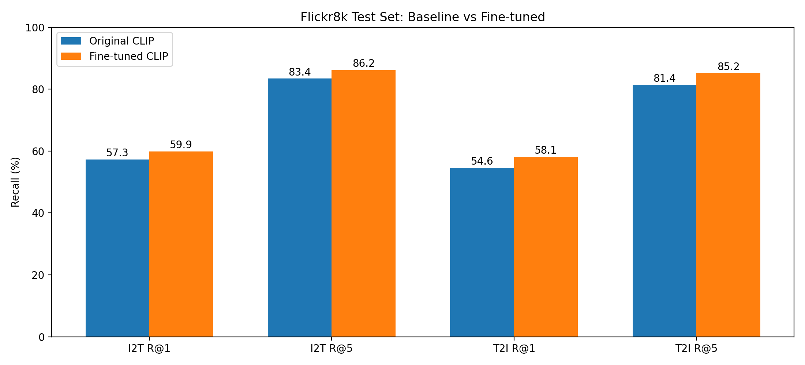
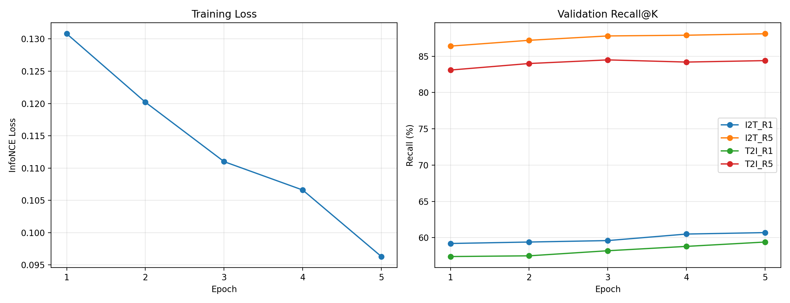
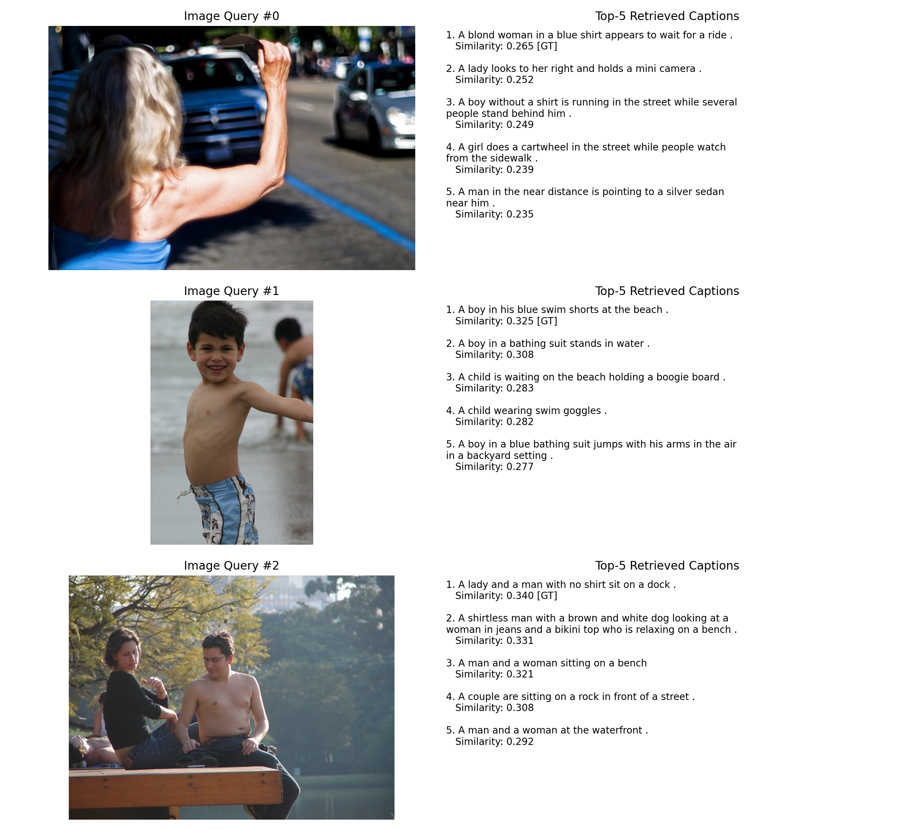
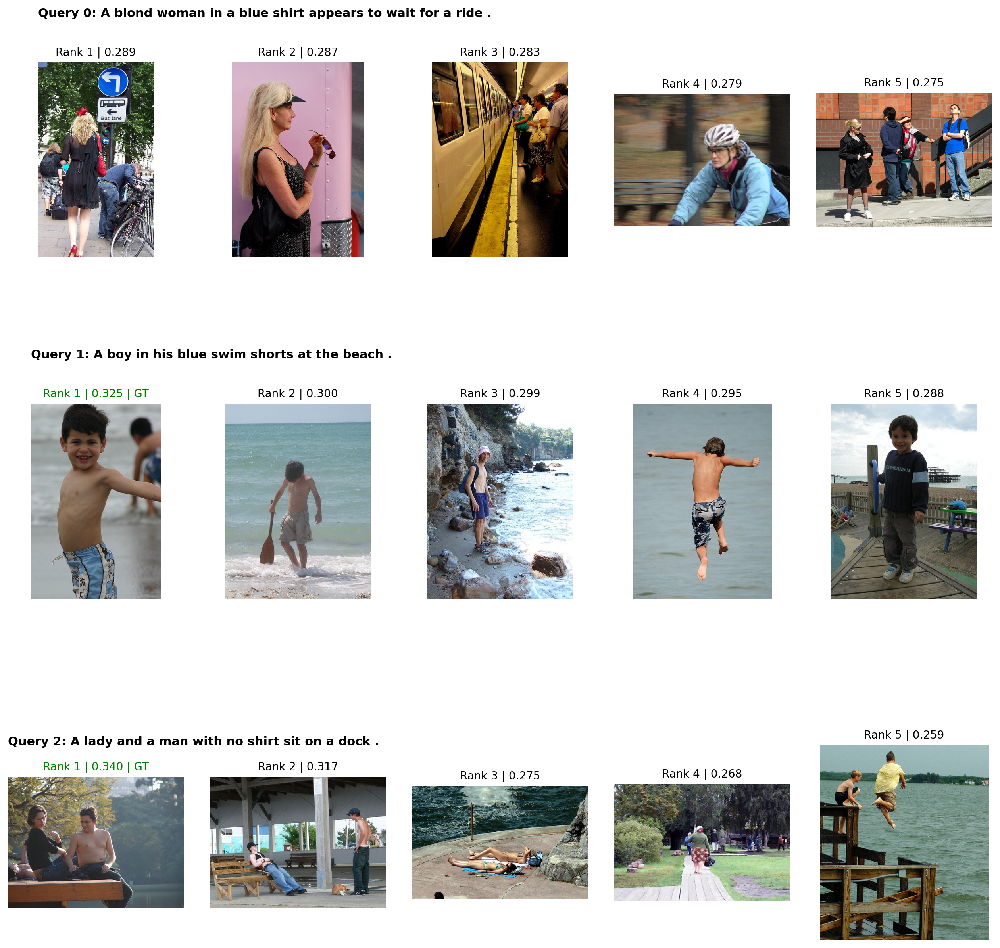
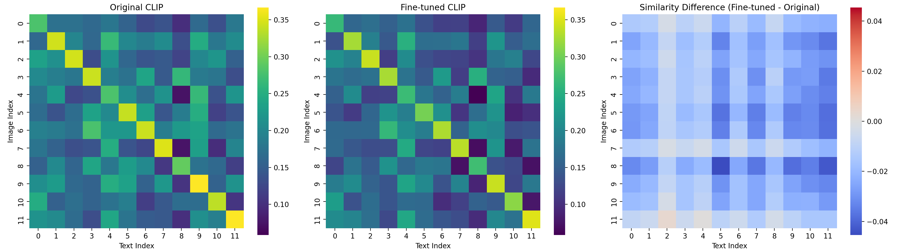

# CILP — Vision–Language Alignment, Qwen3-VL QLoRA & Evaluation

**Two complementary experiments on an 8 GB GPU:** (1) CLIP-style image–text representation alignment and retrieval on Flickr8k; (2) Qwen3-VL-2B-Instruct 4-bit QLoRA instruction tuning for document VQA and an earlier image captioning experiment. Includes quantitative evaluation, error analysis, and a controlled single-run LoRA rank sweep.

> **Best held-out test result (single-caption protocol):** Image→Text R@1 **59.90%** (+2.60 percentage points); Text→Image R@1 **58.10%** (+3.50 percentage points) compared with the original CLIP ViT-B/32.



## Quickstart and script guide

**Always run commands from the repository root** (the directory containing `README.md`). Scripts live under `experiments/`, and root-relative paths such as `data/`, `images/`, `results/` and `checkpoints/` stay unchanged. Use `python -m` rather than executing a nested script by filename, so the top-level `clip_align` imports resolve correctly.

| Task | Command | Output |
|---|---|---|
| Prepare Flickr8k (CLIP) | `python -m experiments.clip.prepare_data` | `data/{train,val,test}.csv`, `images/` |
| Train teaching dual encoder | `python -m experiments.clip.train --train-csv data/train.csv --val-csv data/val.csv --image-dir images --batch-size 4 --epochs 5` | `checkpoints/best.pt` |
| Evaluate teaching dual encoder | `python -m experiments.clip.evaluate --checkpoint checkpoints/best.pt --val-csv data/test.csv --image-dir images` | retrieval metrics |
| CLIP zero-shot validation | `python -m experiments.clip.clip_baseline` | `results/clip_baseline.csv` |
| Fine-tune pretrained CLIP | `python -m experiments.clip.finetune_clip` | `checkpoints/clip_finetune/best/` |
| CLIP held-out test | `python -m experiments.clip.test_clip` | `results/final_test.csv` |
| CLIP plots | `python -m experiments.clip.visualize_clip` | `results/visualization/` |
| Prepare DocVQA | `python -m experiments.vlm.prepare_docvqa` | `data/multitask/{train,val}.jsonl` and images |
| Qwen3-VL QLoRA rank sweep | `python -m experiments.vlm.train_qlora --rank 4` | `checkpoints/qwen3_vl_docvqa_r4/` |
| Evaluate selected adapter | `python -m experiments.vlm.evaluate_docvqa --adapter-path checkpoints/qwen3_vl_docvqa_r4` | `results/docvqa/qwen3_vl_docvqa_r4_predictions.csv` |
| Compare old DocVQA predictions | `python -m experiments.analysis.compare_docvqa` | console error analysis |
| Earlier caption SFT data | `python -m experiments.vlm.prepare_sft_data` | `data/{train,val}.jsonl` |
| Earlier caption evaluation | `python -m experiments.vlm.evaluate_qlora` | `results/qlora_*_short.csv` |
| Caption length / CLIP diagnostics | `python -m experiments.analysis.analyze_qlora` and `python -m experiments.analysis.evaluate_clipscore` | `results/qlora_*.csv` |

**Dependency note:** `requirements.txt` reflects the minimal CLIP setup, not a fully pinned QLoRA environment. VLM tasks additionally need compatible CUDA PyTorch, Transformers, PEFT, bitsandbytes, datasets, PIL, sacrebleu, and rouge-score. `evaluate_qlora` uses the historical caption adapter path, while `evaluate_docvqa` accepts any existing DocVQA adapter via `--adapter-path`. Keep these experiments separate.

### Source tree

```text
CILP/
├── clip_align/                # Shared teaching dual-encoder package
│   ├── model.py
│   ├── data.py
│   └── evaluation.py
├── experiments/
│   ├── clip/                  # Flickr8k alignment, retrieval, CLIP fine-tuning
│   ├── vlm/                   # Qwen3-VL training, DocVQA, captioning
│   └── analysis/              # Error, length, CLIP similarity diagnostics
├── assets/                    # Visualizations embedded in README
├── results/                   # Checked-in metrics and predictions
├── examples/
├── README.md
└── requirements.txt
```

## Highlights

- **From independently pretrained encoders:** ResNet18 + DistilBERT, separate trainable linear projection heads, L2-normalized embeddings, learned logit scale, symmetric image–text InfoNCE.
- **Pretrained CLIP benchmark:** `openai/clip-vit-base-patch32` evaluated without further training.
- **Lightweight adaptation:** froze **both** CLIP vision and text encoders; trained the existing image projection, text projection, and `logit_scale` using BF16 autocast. The final checked-in script does **not** unfreeze any Transformer blocks.
- **Honest evaluation:** disjoint Flickr8k splits, one caption per image, bidirectional Recall@1/5, final comparison on a separate test split.
- **Visual diagnostics:** training curves, baseline comparison, similarity/difference heatmaps, and Top-5 retrieval examples.
- **Qwen3-VL QLoRA:** 4-bit NF4 model, train LoRA on language-model Q/V projections, assistant-only label masking, gradient checkpointing and accumulation; 300 DocVQA training samples.
- **DocVQA rank sweep:** r=4/8/16 with alpha=2r; same 50-example validation subset, reporting EM, ANLS, training loss and peak allocated VRAM.
- **Caption diagnostics:** BLEU-4, ROUGE-L, CLIP-based similarity, response-length and per-example analyses from the earlier caption-focused adapter.

## Results

### Held-out Flickr8k test split

| Metric | Original CLIP | Fine-tuned CLIP | Change |
|:--|--:|--:|--:|
| Image → Text Recall@1 | 57.30% | **59.90%** | **+2.60 pp** |
| Image → Text Recall@5 | 83.40% | **86.20%** | **+2.80 pp** |
| Text → Image Recall@1 | 54.60% | **58.10%** | **+3.50 pp** |
| Text → Image Recall@5 | 81.40% | **85.20%** | **+3.80 pp** |

Mean bidirectional R@1: **55.95% → 59.00%** (+3.05 pp).

Raw numbers: [`results/final_test.csv`](results/final_test.csv).

**Evaluation caveat:** this is a **single-caption Flickr8k retrieval protocol** (one caption per image), **not** the conventional five-caption Flickr8k benchmark. Numbers should not be directly compared with standard leaderboard results. A retrieval hit is defined by the matching row index; semantically valid alternative captions/images may still be counted as misses.

### Validation learning curve



Five-epoch run, learning rate `1e-6`, batch size `16`:

| Epoch | Train InfoNCE | I2T R@1 | I2T R@5 | T2I R@1 | T2I R@5 |
|--:|--:|--:|--:|--:|--:|
| 1 | 0.1308 | 59.20% | 86.40% | 57.40% | 83.10% |
| 2 | 0.1202 | 59.40% | 87.20% | 57.50% | 84.00% |
| 3 | 0.1110 | 59.60% | 87.80% | 58.20% | 84.50% |
| 4 | 0.1066 | 60.50% | 87.90% | 58.80% | 84.20% |
| 5 | 0.0963 | **60.70%** | **88.10%** | **59.40%** | **84.40%** |

**Important:** the InfoNCE training-loss magnitude depends on batch size and the number of in-batch negatives. Do not compare loss values across batch sizes as though they share the same difficulty. Validation numbers were used for model selection; the held-out test results above are the primary reported outcome.

### Earlier experimental baselines (validation split)

| Model / experiment | I2T R@1 | I2T R@5 | T2I R@1 | T2I R@5 |
|:--|--:|--:|--:|--:|
| ResNet18 + DistilBERT, frozen encoders, trained projections | 7.90% | 23.80% | 8.00% | 23.00% |
| Original pretrained CLIP, zero-shot | 56.90% | 84.60% | 55.70% | 82.10% |
| CLIP, first 1-epoch run at LR `1e-5`, batch 2 | 55.50% | 81.30% | 49.60% | 76.30% |
| CLIP, 1-epoch run at LR `1e-6`, batch 2 | 58.30% | 86.00% | 57.70% | 82.70% |
| CLIP, 1-epoch run at LR `1e-6`, batch 16 | 58.80% | 86.20% | 56.70% | 82.80% |

These are experiment observations, not proof that learning rate or batch size alone caused the differences. For controlled comparisons, fix trainable modules, random seeds, data ordering, and the number of optimizer updates; repeat across multiple seeds.

## Qwen3-VL: document VQA and image captioning

### Model and fine-tuning setup

- **Base model:** `Qwen/Qwen3-VL-2B-Instruct` loaded in **4-bit NF4** with double quantization and BF16 compute on an NVIDIA RTX 5060 (8 GB).
- **DocVQA training:** `experiments/vlm/prepare_docvqa.py` uses `nielsr/docvqa_1200_examples`, selects 300 training and 50 held-out validation examples from its train split (seed 42); this is an **internal split, not an official DocVQA benchmark/test score**.
- **LoRA targets:** language-model `q_proj` and `v_proj` layers; rank r∈{4, 8, 16}, alpha=2r, dropout=0.05.
- **Training:** one epoch, 300 samples, per-step microbatch 1, gradient accumulation 8, 38 optimizer updates, AdamW learning rate 1e-4. The training script masks prompt/image/user tokens in `labels` and optimizes assistant answer tokens only.
- **Evaluation:** 50-question validation subset, deterministic decoding and multi-reference normalized Exact Match (EM) / Average Normalized Levenshtein Similarity (ANLS). Different metrics can disagree; EM counts exact accepted answers while ANLS also rewards certain near-matches.

### DocVQA LoRA rank ablation

| Metric | Unadapted baseline | Rank 4 | Rank 8 (rerun) | Rank 16 |
|:--|--:|--:|--:|--:|
| Exact Match (50 examples) | 64.00% | **68.00%** | **68.00%** | 66.00% |
| ANLS | **78.97%** | 77.91% | 77.91% | 77.89% |
| Epoch mean training loss | — | 0.3932 | 0.3783 | **0.3655** |
| Peak allocated training VRAM (GB) | — | 4.02 | 4.03 | 4.05 |
| Peak allocated evaluation VRAM (GB) | — | 1.65 | 1.65 | 1.66 |

Values were recorded from **user-run experiments on November 13, 2026**; these newly reported rank-sweep prediction CSVs and adapters are not yet committed. This table records **one training seed / one 50-example validation subset**, not statistical evidence that one rank consistently outperforms another. One EM item moves the score by 2 percentage points. The r=4 and r=8 runs tie in EM and ANLS; r=16 has lower training loss but no validation improvement. All tuned variants have lower ANLS than the unadapted baseline.

Rank-sweep summary: [`results/docvqa/rank_ablation_summary.csv`](results/docvqa/rank_ablation_summary.csv). Earlier r=8 results (EM 66.00%, ANLS 75.91%) came from a different historical run and are **not** used as the controlled r=8 row above.

The earlier error-comparison script `experiments/analysis/compare_docvqa.py` compares `results/docvqa/baseline_predictions.csv` with `finetuned_predictions.csv` and recorded 2 improved, 5 regressed, 43 unchanged by ANLS, for that **earlier adapter**. Do not confuse those pairwise counts with the new rank sweep.

### Image-caption generation evaluation (earlier adapter)

Separate image-caption experiments used `experiments/vlm/evaluate_qlora.py`, `experiments/analysis/analyze_qlora.py`, `experiments/analysis/analyze_errors.py`, and `experiments/analysis/evaluate_clipscore.py`. The checked-in caption evaluation script points to `checkpoints/qwen3_vl_lora_200`, **not** the newer 300-sample DocVQA rank-sweep adapters.

| Metric | Baseline | Fine-tuned | Change |
|:--|--:|--:|--:|
| Caption BLEU-4 (original prompt) | 1.6556 | 6.6534 | +4.9979 |
| Caption ROUGE-L (original prompt) | 18.1215 | 37.9750 | +19.8535 |
| Caption BLEU-4 (short-answer prompt) | 4.3192 | 8.5844 | +4.2652 |
| Caption ROUGE-L (short-answer prompt) | 33.4386 | 38.1584 | +4.7199 |

These are **50-sample caption experiments**, with changes measured in score points, not percentage-point gains in accuracy. Reference-overlap metrics are affected by response length and prompt constraints; improvements do not automatically establish better factual grounding. The script named `experiments/analysis/evaluate_clipscore.py` computes a scaled CLIP cosine similarity as a diagnostic, not a separately validated faithful-captioning accuracy measure. Per-example results and caption lengths are in `results/qlora_*.csv`.

### Reproduce DocVQA training and evaluation

Prepare the internal DocVQA split (downloads external data; images and JSONL are not committed):

```powershell
python -m experiments.vlm.prepare_docvqa
```

The `experiments/vlm/train_qlora.py` script currently supports ranks 4, 8, and 16; each gets its own adapter directory:

```powershell
python -m experiments.vlm.train_qlora --rank 4
python -m experiments.vlm.train_qlora --rank 8
python -m experiments.vlm.train_qlora --rank 16
```

Evaluate each adapter, generating separate prediction CSVs:

```powershell
python -m experiments.vlm.evaluate_docvqa --adapter-path checkpoints/qwen3_vl_docvqa_r4
python -m experiments.vlm.evaluate_docvqa --adapter-path checkpoints/qwen3_vl_docvqa_r8
python -m experiments.vlm.evaluate_docvqa --adapter-path checkpoints/qwen3_vl_docvqa_r16
```

Local outputs: `results/docvqa/qwen3_vl_docvqa_r{4,8,16}_predictions.csv`. The existing `experiments/analysis/compare_docvqa.py` defaults to old prediction-file names and must be adapted if comparing new rank-sweep predictions. The repository deliberately excludes `data/`, `images/`, and `checkpoints/` from Git. QLoRA requires compatible CUDA/PyTorch/Transformers/PEFT/bitsandbytes versions in addition to the minimal CLIP requirements; no fully pinned QLoRA environment is currently provided.

## Retrieval visualizations

### Image → Text: top-five captions



### Text → Image: top-five images



The sample visualizations include both successful and unsuccessful retrievals. **GT** denotes the single paired item from the CSV, not necessarily the only semantically valid match.

### Cosine-similarity heatmaps



The first two panels share one data-dependent color scale; the third shows `fine_tuned_similarity - original_similarity`. Higher similarity is not automatically an improvement: correct-pair **ranking relative to competing matches** is what drives Recall@K.

## Architecture

### A. Minimal CLIP-style alignment

```text
RGB image -> ResNet18 (pretrained, frozen) -- [B,512] -- Linear(512,256) -- L2 norm --+
                                                                                       |-> scaled similarity [B,B]
Caption   -> DistilBERT (pretrained, frozen) -- [B,768] -- Linear(768,256) -- L2 norm -+
                                                                                       -> symmetric InfoNCE
```

The two encoders are pretrained **independently**, not jointly image–text aligned. The projection heads and temperature parameter learn cross-modal alignment from paired data. This is a teaching/research baseline, **not an exact reproduction of the original CLIP architecture or pretraining regime**.

### B. Adapt pretrained CLIP ViT-B/32

```text
Image -> pretrained CLIP vision encoder (frozen) -> visual_projection (trainable) --+
                                                                                    |-> InfoNCE
Text  -> pretrained CLIP text encoder   (frozen) -> text_projection   (trainable) --+
                                     logit_scale (trainable)
```

Final checked-in `experiments/clip/finetune_clip.py` configuration:

| Setting | Value |
|:--|:--|
| GPU used | NVIDIA RTX 5060, 8 GB VRAM |
| Backbone | `openai/clip-vit-base-patch32` |
| Encoder parameters | Frozen (vision and text) |
| Trainable parameters | Both projection layers + logit scale |
| Precision | BF16 autocast |
| Batch size | 16 |
| Learning rate | 1e-6 |
| Epochs | 5 |
| Optimizer | AdamW, weight decay 0.01 |
| Loss | Bidirectional in-batch InfoNCE |
| Checkpoint criterion | Mean of validation I2T/T2I R@1 |

Small-batch contrastive learning has few in-batch negatives; gradient accumulation alone does not create additional in-batch negative examples. The final 16-pair run used more negatives than the earlier two-pair runs.

## Reproduce

### 1. Conda / Python environment

```powershell
conda create -n cilp python=3.11 -y
conda activate cilp

# Example CUDA wheel index; choose a PyTorch build compatible with your GPU/driver.
python -m pip install torch torchvision --index-url https://download.pytorch.org/whl/cu128
python -m pip install -r requirements.txt

# Additional dependencies used by data preparation and visualizations:
python -m pip install datasets tqdm matplotlib seaborn

python -c "import torch; print(torch.cuda.is_available(), torch.__version__)"
```

There is no official separate `transformers-gpu` package: CUDA support comes from PyTorch.

### 2. Prepare Flickr8k

```powershell
python -m experiments.clip.prepare_data
```

The script reads Hugging Face dataset `intro/flickr8k`, uses the `train`, `dev`, and `test` splits, and keeps `caption_0` for each image. It saves `images/<split>_<index>.jpg` and `data/train.csv`, `data/val.csv`, `data/test.csv` with CSV columns `image,caption`. Expect approximately 6,000 / 1,000 / 1,000 pairs. The data must be downloaded separately.

### 3. Minimal alignment experiment

```powershell
python -m experiments.clip.train --train-csv data/train.csv --val-csv data/val.csv --image-dir images --batch-size 4 --epochs 5
python -m experiments.clip.evaluate --checkpoint checkpoints/best.pt --val-csv data/test.csv --image-dir images
```

`experiments/clip/train.py` also supports `--resume checkpoints/best.pt`; if the checkpoint contains optimizer state, that is restored too. `--epochs` means **additional epochs** when resuming. The checkpoint tracks the **best validation** epoch, not necessarily the latest epoch.

### 4. Pretrained CLIP and fine-tuning

```powershell
python -m experiments.clip.clip_baseline
python -m experiments.clip.finetune_clip
python -m experiments.clip.test_clip
python -m experiments.clip.visualize_clip
```

- `experiments/clip/clip_baseline.py` evaluates on **validation**, not test.
- `experiments/clip/finetune_clip.py` saves a Hugging Face model and processor at `checkpoints/clip_finetune/best`.
- `experiments/clip/test_clip.py` evaluates **both** original and fine-tuned CLIP on the same held-out **test** split and writes `results/final_test.csv`.
- `experiments/clip/visualize_clip.py` saves plots in `results/visualization/`; the checked-in script contains the recorded five-epoch history and test numbers for its charts. Rerun retrieval for the heatmap and examples.
- Fine-tuning starts from the original pretrained CLIP when re-executed; this script **does not support optimizer-state resume**.

**Note:** Load/preprocessing behavior and hardware compatibility depend on installed PyTorch/Transformers versions. Store exact package versions and random seeds before a formal replication study.

## Limitations & next steps

- Extend to **five captions per image** with correct multi-positive retrieval evaluation and loss.
- Run repeated seeds and controlled trainable-parameter/batch-size ablations.
- Add experiment-config, metrics-CSV, and checkpoint version tracking rather than manually entering historical curves.
- Optimize or chunk large `N × N` retrieval similarity calculations for bigger datasets.
- Explore LoRA / partial encoder adaptation and more diverse image–text datasets.
- Qwen3-VL instruction tuning is now implemented; validate on larger held-out splits and multiple seeds before claiming a reliable rank winner.
- Commit the three new local rank-sweep prediction CSVs after reviewing them; this README already records the reported aggregate results.
- Add pinned QLoRA dependencies and environment details for exact reproducibility.
- Future projects beyond this repository: visual grounding, domain-specific industrial-document VLM experiments, agent harness, and action-conditioned world models.

## License and data

Flickr8k images are **not included**. Follow the original dataset’s license and usage terms. Pretrained CLIP, ResNet18, and DistilBERT retain their respective model licenses; consult upstream sources before redistribution.
